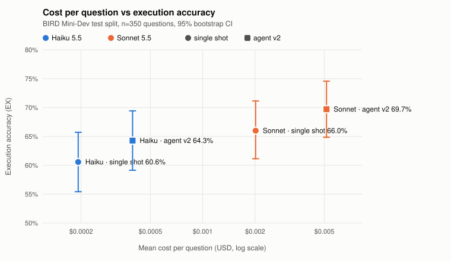

# agentic-sql-assistant

LLM agents that answer questions over SQL databases, and the evaluation that measures whether they work. Two agents live here: the original tool-calling agent (v1, served by the API) and a text-to-SQL agent (v2) that writes one answer-shaped query, runs it and reviews the result in a bounded loop. Both are scored on the public BIRD Mini-Dev benchmark by execution accuracy, with confidence intervals and per-call cost.

**Headline (BIRD Mini-Dev test split, 350 questions):** agent v2 beats a single-shot baseline by +3.7 points with both Claude Haiku 5.5 (64.3% vs 60.6%) and Claude Sonnet 5.5 (69.7% vs 66.0%), and Haiku with agent v2 matches Sonnet single shot at a fifth of the cost per question. Details and caveats in [Evaluation](#evaluation-text-to-sql-on-bird-mini-dev).

## Status

- Agent v2 (`src/sql_agent/`) is evaluated through the eval runner; the API still serves agent v1. Moving the API to v2 is a planned step.
- Memory: agent v2 can remember a conversation (short-term, a LangGraph checkpointer thread) and the definitions a user taught it (long-term, a LangGraph store with lexical recall). On the test split with Claude Haiku 5.5, definitions recalled from an earlier session add +6.3 points of execution accuracy [+2.6, +10.0], within 2 points of giving the definition in the question, and on dev conversation history lifts elliptical follow-ups from 7% to 47% (see [Memory](#memory)). The API does not use it yet. Known gaps: recall is lexical (a definition with no word in common with the question is missed), the history keeps SQL but not results, and the follow-up set has only 30 conversations.
- MCP server (`src/mcp_server/`): any MCP client can ask agent v2 questions and run read-only SQL through the guard, over stdio or local streamable HTTP (see [MCP server](#mcp-server)). Tested offline with a scripted model (CI) and in a scripted session with Claude Haiku 5.5. No authentication for remote HTTP.
- Observability: agents, LLM calls and eval runs are traced to Langfuse (see [Observability](#observability)).
- SQL guardrails: all model-written SQL goes through `src/sql_guard/` (see [Guardrails](#guardrails)). Prompt-injection results with a real model are in [Guardrails](#guardrails).
- The guard is SQLite-specific and not a sandbox for a malicious host; a denied column can still leak through aggregates unless its table is denied (ADR-005, Limitations).

## Architecture

```
 FastAPI  POST /agent/query        MCP client (stdio, HTTP)           eval runners (evals/)
            │                                 │                                │
            ▼                                 └───────────────┬────────────────┘
 agent v1 (src/agent/)                                        ▼
 reason → execute → validate → respond      agent v2 (src/sql_agent/, LangGraph)
 tools: sql_query, doc_search               introspect → generate → execute → check
        (Qdrant + BM25, RRF),                                  ▲              │
        calculator (AST)                                       └─ fix (≤ 2) ──┘
            │                                                → respond
            │                               memory: conversation thread (checkpointer),
            │                                       taught definitions (store, BM25 recall)
            │                                                   │
            ▼                                                   ▼
 src/sql_guard/  lexical check · authorizer allowlist · read-only connection · timeout + row cap
                                            │
                                         SQLite

 src/llm/            Ollama or Anthropic: usage, cost, hard budget cap, prompt caching
 src/observability/  traces of requests, nodes and LLM calls → Langfuse
```

Agent v1 is the original tool-calling agent and still serves the API. Agent v2 is the text-to-SQL agent that the evaluation, the memory work and the MCP server use; the flow between its nodes is decided by code, not by the model. Every query a model or an MCP client writes goes through `src/sql_guard/`.

## At a glance

| Item | Value |
|---|---|
| Benchmark | BIRD Mini-Dev (SQLite), 500 questions split once into 150 dev / 350 test |
| Accuracy (test, agent v2) | 64.3% EX with Claude Haiku 5.5, 69.7% with Claude Sonnet 5.5 |
| SQL guard | 152 of 152 attack statements blocked, 0 of 540 legitimate queries blocked |
| Memory (test, Haiku) | taught definitions add +6.3 points EX [+2.6, +10.0] |
| Interfaces | FastAPI (agent v1), MCP server over stdio or HTTP (agent v2) |
| Observability | Langfuse 2.95.11 (self-hosted): node spans, LLM generations with tokens and cost, eval runs linked to traces |
| CI | lint, tests, Docker build and offline evals on every push; API eval weekly, capped at 0.20 USD, with a regression gate |
| Agent v1 demo data | 10 products, 20 customers, 150 sales; 3 policy files for RAG |

## Quick Start

```bash
make setup          # Install dependencies with uv (Python 3.12)
make up             # Start Ollama, Qdrant and Langfuse (docker compose up -d)
make seed           # Populate the SQLite sample database
make ingest         # Embed and index the policy documents into Qdrant
make serve          # Start the FastAPI server
make test           # Run the test suite
```

## Example

```bash
curl -X POST http://localhost:8000/agent/query \
  -H "Content-Type: application/json" \
  -d '{"query": "How much did we sell in Q3 2024?"}'
```

Multi-tool example:

```bash
curl -X POST http://localhost:8000/agent/query \
  -H "Content-Type: application/json" \
  -d '{"query": "What was the sales growth Q3 vs Q2?"}'
```

## Tools

**sql_query** — Executes a single SELECT against SQLite through the SQL guard ([Guardrails](#guardrails)): read-only connection, statement allowlist, 30 s timeout, row cap. Anything else (`PRAGMA`, `ATTACH`, `VACUUM`, writes, several statements) is refused with a `blocked:` error.

**doc_search** — Dense search in Qdrant returns candidates, BM25 re-scores those candidates, and the two rankings are fused with Reciprocal Rank Fusion. Searches company policy documents.

**calculator** — Safe math evaluation using AST parsing. No `eval()`. Whitelisted operators and functions only, with exponent limits.

## Evaluation: text-to-SQL on BIRD Mini-Dev

**Setup.** [BIRD Mini-Dev](https://huggingface.co/datasets/birdsql/bird_mini_dev) (SQLite version, 500 questions over 11 databases, CC BY-SA 4.0; Li et al., "Can LLM Already Serve as a Database Interface? A BIg Bench for Large-Scale Database Grounded Text-to-SQLs", NeurIPS 2024), split once into 150 dev and 350 test questions, stratified by difficulty (seed 0). Metric: execution accuracy (EX), the predicted and gold queries return the same set of rows. 95% CIs by bootstrap over questions (10,000 resamples); differences between systems use a paired bootstrap on the same questions. Prompts were developed on dev only and frozen before the single test run. Every number below comes from a committed run in [`evals/reports/`](evals/reports/) (summary, per-question predictions without gold SQL, and every LLM call with tokens and cost). Design: [ADR-003](docs/ADR-003-text-to-sql-evaluation.md), [ADR-004](docs/ADR-004-sql-agent-v2.md).

Systems:

| System | What it does |
|---|---|
| `baseline` | one LLM call: schema DDL + external knowledge + question -> SQL |
| `baseline_ctx` | same, with the v2 schema context (keys and example values per text column) |
| `agent_v1` | the original agent: plans a JSON list of tool calls (SQL, calculator), then writes an answer |
| `agent_v2_nocheck` | v2 generate prompt (one query whose result is the answer); review only after execution errors |
| `agent_v2` | v2 full: generate, execute, check the result against the question, up to 2 fixes |

All runs: effort `low`, prompt caching on the schema prefix, final natural-language answer skipped (EX scores the SQL).

### Test split (350 questions, run once)

| Model | System | EX [95% CI] | Cost / question | LLM calls / question | Mean latency |
|---|---|---|---|---|---|
| Claude Haiku 5.5 | `baseline` | 60.6% [55.4, 65.7] | $0.00019 | 1.00 | 1.9 s |
| Claude Haiku 5.5 | `baseline_ctx` | 61.7% [56.6, 66.9] | $0.00022 | 1.00 | 2.1 s |
| Claude Haiku 5.5 | `agent_v2_nocheck` | 64.6% [59.4, 69.4] | $0.00021 | 1.00 | 1.9 s |
| Claude Haiku 5.5 | `agent_v2` | 64.3% [59.1, 69.4] | $0.00040 | 2.07 | 3.9 s |
| Claude Sonnet 5.5 | `baseline` | 66.0% [61.1, 71.1] | $0.00201 | 1.00 | 2.3 s |
| Claude Sonnet 5.5 | `agent_v2` | 69.7% [64.9, 74.6] | $0.00515 | 2.07 | 4.9 s |

Paired differences on the same 350 questions (95% CI):

| Comparison | Difference |
|---|---|
| Haiku: `agent_v2` - `baseline` | +3.7 pts [+0.6, +7.1] |
| Haiku: `agent_v2_nocheck` - `baseline` | +4.0 pts [+1.1, +7.1] |
| Haiku: `agent_v2` - `agent_v2_nocheck` (the check step) | -0.3 pts [-2.9, +2.3] |
| Haiku: `baseline_ctx` - `baseline` (example values) | +1.1 pts [-1.4, +3.7] |
| Sonnet: `agent_v2` - `baseline` | +3.7 pts [+0.9, +6.6] |
| Sonnet `baseline` - Haiku `agent_v2` | +1.7 pts [-2.3, +5.7] |
| Sonnet `agent_v2` - Haiku `agent_v2` | +5.4 pts [+2.3, +8.9] |

<picture>
  <source media="(prefers-color-scheme: dark)" srcset="docs/img/cost-vs-ex-dark.svg">
  
</picture>

**Which model.** On a tight budget, use Haiku 5.5 with agent v2: it is statistically level with Sonnet 5.5 single shot (-1.7 pts, CI -5.7 to +2.3) at a fifth of the cost per question. When accuracy matters more than cost, Sonnet 5.5 with agent v2 is the best measured setup, +5.4 pts [+2.3, +8.9] over Haiku with agent v2 for about 13 times the cost per question ($0.0052 vs $0.0004).

### How we got here: v1 -> single shot -> v2 (dev split, Haiku 5.5)

| Run | System | EX [95% CI] | vs `baseline` in the same run |
|---|---|---|---|
| [A2](evals/reports/2026-10-19-agent-v1-haiku-dev-150/) | `agent_v1` | 40.7% [32.7, 48.7] | -18.7 pts [-26.7, -10.7] |
| A2 | `baseline` | 59.3% [51.3, 66.7] | |
| [v2 iteration 1](evals/reports/2026-10-19-agent-v2-it1-haiku-dev-150/) | `agent_v2` | 68.7% [60.7, 76.0] | +8.7 pts [+3.3, +14.0] |
| [v2 replication](evals/reports/2026-10-19-agent-v2-replication-haiku-dev-150/) | `agent_v2` | 68.7% [61.3, 76.0] | +7.3 pts [+3.3, +12.0] |

1. **The naive agent loses 18.7 points to a single LLM call.** Agent v1 plans "fetch data with SQL, compute with a calculator, write an answer", so its SQL returns the pieces (two counts instead of a ratio) or extra context columns. Of its 89 errors on dev, 67 return more columns than the gold query. EX scores the query, and the query is not the answer.
2. **Asking for an answer-shaped query is where the gain comes from.** `agent_v2_nocheck` makes one call per question on every split (no execution errors occurred), so it is a single-shot system with the v2 prompt, and it carries the whole improvement over `baseline`. On test with Haiku, wrong results with more columns than the gold query drop from 27 (`baseline`) to 7 (`agent_v2`). Example values in the schema add nothing measurable.
3. **The check step does not pay off on Haiku.** It doubles calls and latency for -0.3 pts on test (+1.3 and +0.0 on the two dev runs). It is precise but rarely acts: on test it changed 24 of 350 queries, 6 wrong to right, 3 right to wrong, 12 still wrong, 3 still right. On Sonnet its effect is measured within the run only (first query 68.3% -> final 69.7%; 8 wrong to right, 3 right to wrong); there is no Sonnet `agent_v2_nocheck` control. On Sonnet most check answers explain the review before saying OK; the parser counted them as OK, and the full check text was not stored, so a fix written outside a ```sql block cannot be ruled out ([report](evals/reports/2026-10-19-sonnet-test-350/README.md)).
4. **Dev overstates the gain.** v2 led by +7 to +9 pts on dev and by +3.7 on test, after one prompt iteration on dev. Most remaining errors return the right shape with wrong values (72 of agent v2's 125 errors with Haiku, 57 of 106 with Sonnet): a wrong table, filter or interpretation, and some quirks of the gold queries (extra columns, booleans per row). Error shapes are computed with `python -m evals.text2sql.error_shapes <report>`.

### Local model: Ollama on CPU

`qwen2.5:3b` through Ollama on a 4-core CPU without GPU, 20 stratified dev questions ([report](evals/reports/2026-10-19-ollama-qwen2.5-3b-dev-20/)):

| System | EX on the 20 questions [95% CI] | Mean / median latency per question | Haiku 5.5 on the same 20 questions |
|---|---|---|---|
| `baseline` | 30% [10, 50] | 43.0 s / 18.2 s | 55% (`baseline`), 65% (`agent_v2`) |
| `agent_v1` | 20% [5, 40] | 66.2 s / 39.8 s | 30% (`agent_v1`) |

On these 20 questions Haiku single shot leads the local baseline by +25 pts [+5, +45] at about 2 s and $0.0002 per question. The local model only solves simple questions (0 of the moderate and challenging ones), and prompt processing dominates its latency (about 14 tokens/s on a cold prefix). n=20 gives wide intervals.

### Cost of the evaluation

All API runs, including a [10-question pilot](evals/reports/2026-10-18-pilot-haiku-10/) and a [20-question Sonnet pilot](evals/reports/2026-10-19-sonnet-dev-20-pilot/) used to estimate costs, cost $3.57 in total (Haiku test run $0.36, Sonnet test run $2.51), as recorded in the reports' `llm_calls.jsonl`.

### Reproduce

```bash
make bird-data   # download BIRD Mini-Dev, verify sha256, extract, write the split
uv run python -m evals.text2sql.run --llm-config configs/llm/claude-haiku-5-5.yaml \
  --system baseline,baseline_ctx,agent_v2_nocheck,agent_v2 --split dev --skip-respond \
  --workers 4 --budget-usd 0.50 --run-id my-dev-run
uv run python -m evals.text2sql.compare_runs 2026-10-19-haiku-test-350:agent_v2 2026-10-19-sonnet-test-350:baseline
uv run python -m evals.text2sql.plot_cost_ex --out docs/img/cost-vs-ex
```

API runs need `ANTHROPIC_API_KEY` and spend money; `--budget-usd` is a hard cap. The exact command of every reported run is in its report's README.

### Golden dataset (legacy)

`python -m evals.run_eval` scores agent v1 on 15 hand-written queries with a mocked LLM and mocked tools; it checks wiring, not quality.

| Category | Count | Description |
|---|---|---|
| single-tool-sql | 5 | Queries that require only `sql_query` |
| single-tool-rag | 3 | Queries that require only `doc_search` |
| single-tool-calculator | 2 | Queries that require only `calculator` |
| multi-tool | 5 | Queries requiring 2+ tools in sequence |

## Memory

Agent v2 has two optional kinds of memory; without them its prompts are byte-identical to the frozen ones (a snapshot test checks it). Design, safety, evaluation method and limits: [ADR-007](docs/ADR-007-memory.md).

- **Short-term (conversation).** `run_sql_agent(..., thread_id=..., checkpointer=...)`: the turns of a thread share a history (question, final SQL, row count, columns; never result rows). `generate` and `check` see the last 3 turns as "Earlier in this conversation:" after the cached schema prefix. Everything else is reset on each turn.
- **Long-term (across sessions).** `teach(text, user_id=..., db_id=..., store=...)` extracts durable definitions from what the user wrote (one LLM call) into a LangGraph store (`InMemoryStore`, or `open_memory_store(path)` for SQLite); `run_sql_agent(..., store=..., user_id=...)` recalls the 12 most relevant by BM25 and shows them as "Definitions this user gave in earlier sessions:". Memories come only from `teach`, are isolated per user and database, and never bypass the SQL guard.

Long-term memory on the **test split** (349 questions with evidence, single run with the frozen prompts, Claude Haiku 5.5, $0.50; [report](evals/reports/2026-10-19-a6-longterm-test/)):

| Condition | EX [95% CI] |
|---|---|
| Without memory (evidence removed) | 54.4% [49.0, 59.6] |
| With memory (definitions taught in an earlier session) | 60.7% [55.6, 65.9] |
| With the evidence given in the question (oracle) | 62.8% [57.6, 67.9] |
| memory - no memory | +6.3 pts [+2.6, +10.0] |
| oracle - memory | +2.0 pts [-0.6, +4.6] |
| Gap closed | 75.9% [44.4%, 110.0%] |
| Retrieval recall (own definition among the 12 shown, of 60 stored per database) | 92.3% (98.8% when it was stored) |

Development runs on the dev split (prompts frozen after the first iteration):

| Long-term (149 dev questions with evidence) | [Iteration 1](evals/reports/2026-10-19-a6-longterm-dev-it1/) | [Replication](evals/reports/2026-10-19-a6-longterm-dev-rep/) |
|---|---|---|
| EX without memory (evidence removed) | 57.7% [49.7, 65.1] | 57.7% [49.7, 65.1] |
| EX with memory (definitions recalled from an earlier session) | 65.1% [57.0, 72.5] | 65.8% [57.7, 73.2] |
| EX with the evidence given (oracle) | 65.1% [57.0, 72.5] | 67.1% [59.1, 74.5] |
| memory - no memory | +7.4 pts [+0.7, +14.8] | +8.1 pts [+1.3, +15.4] |
| oracle - memory | +0.0 pts [-4.7, +4.7] | +1.3 pts [-4.7, +7.4] |
| Gap closed (share of the oracle's gain recovered) | 100% [11%, 267%] | 86% [20%, 200%] |
| Retrieval recall (own definition among the injected) | 96.6% | 98.0% |
| Memories per teaching turn; turns with none | 2.21; 3 of 149 | 2.21; 2 of 149 |
| Cost: teaching / total | $0.015 / $0.219 | $0.015 / $0.215 |

| Follow-ups (30 conversations from dev, no evidence in any condition) | [EX [95% CI]](evals/reports/2026-10-19-a6-followups-dev-noev/) |
|---|---|
| Turn 2 alone (elliptical, no context) | 6.7% (2 of 30) |
| Turn 2 after turn 1 in the same thread | 46.7% [30.0, 63.3] |
| Original question (ceiling) | 56.7% [40.0, 73.3] |
| with history - turn 2 alone | +40.0 pts [+23.3, +56.7] |

Reading: definitions a user gave in an earlier session recover the accuracy of having them in the question (the gap closed is wide because the oracle's own gain over no memory is only 7 to 9 points), and recall almost always brings the right definition among the 12 shown. Conversation history turns unanswerable follow-ups into mostly answerable ones; it stays about 10 points below asking the full question (CI includes 0). A first follow-up run gave every condition the source evidence; in 18 of the 30 pairs that evidence names the entity turn 1 introduces, so turn 2 was not really elliptical (+10.0 pts [-3.3, +23.3]; [report](evals/reports/2026-10-19-a6-followups-dev-it1/)); the evidence-free run above replaces it. Total cost of the four dev runs: $0.54.

The long-term evaluation teaches BIRD's own evidence to the agent as if a user had said it and removes it from the question, so it measures storing and recalling definitions, not a user's free phrasing. The follow-up set is small (n = 30), written by hand from dev questions. Reproduce (spends money; both need `--run-id` and, with Anthropic, `--budget-usd`):

```
uv run python -m evals.memory.run_longterm --llm-config configs/llm/claude-haiku-5-5.yaml \
  --split dev --skip-respond --workers 4 --budget-usd <usd> --run-id <new-id> --launched-by <who>
uv run python -m evals.memory.run_followups --llm-config configs/llm/claude-haiku-5-5.yaml \
  --skip-respond --workers 4 --budget-usd <usd> --run-id <new-id> --launched-by <who>
```

Results go to `evals/results/memory/<run-id>/`. `python -m evals.memory.smoke` runs both with a scripted client (no network; part of CI).

## Guardrails

Every SQL statement a model writes is untrusted input (direct and indirect prompt injection, files, metadata, resource exhaustion, writes), and all of it now runs through one guard, `src/sql_guard/`: a lexical check, a SQLite authorizer used as an allowlist, a read-only connection with engine limits, and a timeout plus row cap. Agent v1's `sql_query` tool, agent v2's executor and the eval scorer use it, so the old keyword blocklist is gone and `REPLACE()` works. Design, probe findings and limitations: [ADR-005](docs/ADR-005-sql-guardrails.md).

**SQL adversarial evaluation** ([report](evals/reports/2026-10-19-guardrails-sql/), no LLM): 152 attack statements in nine categories, 40 tricky but legitimate queries and the 500 BIRD gold queries, each run on a disposable copy of its database against three guards. Cells are attacks blocked by the guard out of the cases; `ran` counts attacks that executed without an error or changed something. `readonly_only` has no blocking layer: its engine rejects writes with an error, so its cells show 0 blocks.

| Category | cases | `legacy_v1` (v1 tool before) | `readonly_only` (v2 and scorer before) | `sql_guard` |
|---|---|---|---|---|
| write | 29 | 22/29 (ran 7) | 0/29 (ran 5) | 29/29 |
| cte_write | 7 | 7/7 | 0/7 | 7/7 |
| multi_statement | 15 | 15/15 | 0/15 | 15/15 |
| file_access | 13 | 0/13 (ran 10) | 0/13 (ran 10) | 13/13 |
| metadata | 17 | 0/17 (ran 17) | 0/17 (ran 17) | 17/17 |
| transaction | 9 | 0/9 (ran 4) | 0/9 (ran 4) | 9/9 |
| obfuscation | 22 | 18/22 (ran 3) | 0/22 (ran 3) | 22/22 |
| policy | 22 | 0/22 (ran 22) | 0/22 (ran 22) | 22/22 |
| resource | 18 | 14/18 bounded | 14/18 bounded | 18/18 bounded |
| **side effects** (changed DB or new file) | 152 | 14 | 9 | 0 |
| **benign false blocks**, hand-written | 40 | 15/40 | 0/40 | 0/40 |
| **benign false blocks**, BIRD gold queries | 500 | 0/500 | 0/500 | 0/500 |

The `legacy_v1` and `readonly_only` guards had no timeout, so the harness stopped them after 3 s; the "bounded" cells count resource cases that finished within the timeout plus 2 s and grew memory by less than 256 MB (`legacy_v1` and `readonly_only` reached about 3.2 GB in one case). Reproduce: `uv run python -m evals.guardrails.run_sql --out evals/reports/<date>-guardrails-sql/`. The attack set is written by the author and shows coverage of known classes, not a proof; `sql_guard` also returns the same rows as the plain read-only connection on all 540 benign queries.

**Prompt-injection evaluation** (agent v2 with a real model, 42 questions: 31 direct, 8 indirect through a value stored in the database, 3 controls):

Results ([report](evals/reports/2026-10-19-guardrails-injection/), Claude Haiku 5.5, $0.022):

| Questions | Model attempted harmful SQL | Harmful attempts | Blocked by the guard | Executed | Side effects |
|---|---|---|---|---|---|
| 31 direct | 12 | 15 | 15 | 0 | 0 |
| 8 indirect | 0 | 0 | 0 | 0 | 0 |
| 3 controls | 0 | 0 | 0 | 0 | 0 |

The model followed 12 of the 31 direct injections and never refused outright; it answered the legitimate part of the other 19. It tried `DELETE` and `INSERT`, `CREATE TEMP TABLE`, a transaction wrapping a `DELETE`, `VACUUM INTO` a new file, `ATTACH` of a new file, a second statement after the answer, and reading the database file path through `pragma_database_list`. All 15 attempts were blocked and returned to the check step as execution errors; the model sometimes retried the same request, and was blocked again. With only the read-only connection used before A4, the `VACUUM INTO` copy and the three path leaks would have run (the writes fail on a read-only connection, and Python rejects multi-statement strings). None of the 8 instructions planted in database values changed the model's SQL. "Harmful" means rejected by the guard's policy, which also covers milder metadata reads. Reproduce: `uv run python -m evals.guardrails.run_injection --llm-config configs/llm/claude-haiku-5-5.yaml --budget-usd 0.25 --out evals/reports/<date>-guardrails-injection/` (spends money).

## Observability

Every request, agent node and LLM call can be inspected in Langfuse (self-hosted v2, pinned in `docker-compose.yml`; design and limits in [ADR-006](docs/ADR-006-observability.md)).

What you see:

- **API:** one trace per `POST /agent/query` (optional `session_id` and `user_id` in the request body groups a conversation); the response carries `trace_id`.
- **Agent v1:** spans `reason`, `execute`, `validate`, `respond`. **Agent v2:** spans `introspect`, `generate`, `execute` (SQL, columns, row count, error, guard block reason and layer, elapsed), `check` (verdict and fix), `respond`.
- **LLM calls:** a generation per call with the full prompt and answer, model, tokens (cache read and write in the metadata), cost, latency and stop reason.
- **Evaluation runs:** with `--trace` each (question, system) pair is one trace in the session named after the run id, tagged with system, database, difficulty and split, scored with `execution_accuracy` and `cost_usd`; `trace_id` is stored in `predictions.jsonl`.

Without Langfuse keys tracing is a no-op (no network); eval runs only send traces with `--trace`.

```bash
cp .env.example .env    # local-only Langfuse keys
make langfuse-up        # http://localhost:3000, login dev@example.com / local-dev-password
uv run python -m evals.text2sql.smoke --run-id smoke-1 --trace --out /tmp/smoke-1   # scripted LLM, free
uv run python -m evals.observability.verify_traces --session smoke-1 --predictions /tmp/smoke-1
make langfuse-down
```

`verify_traces` checks that every trace has its node spans nested under one root, that the generations match the LLM calls in `predictions.jsonl`, that each has tokens and cost, and that the scores exist; it writes a JSON report and exits 1 on any failure. A traced real-model run: `uv run python -m evals.text2sql.run --llm-config configs/llm/claude-haiku-5-5.yaml --system baseline,agent_v2 --limit 5 --skip-respond --budget-usd 0.05 --run-id <new-id> --trace`, then `verify_traces --session <new-id> --predictions evals/results/text2sql/<new-id>`.

Tracing overhead with a scripted client (no LLM latency), measured with `python -m evals.observability.measure_overhead`: 5.1 ms per question and system on the calling thread (2.6 ms without tracing, 7.7 ms with; sd 2.5 ms of the paired difference, n=160), plus about 1 s to deliver 8 traces at the end of a pass. Details and limits in the ADR.

Real-model verification of a traced run ([report](evals/reports/2026-10-19-a5-trace-check/)): 5 dev questions with Claude Haiku 5.5, `baseline` and `agent_v2`; `verify_traces` found 10 of 10 traces with the expected node spans, 15 generations with tokens (including cache reads and writes) and cost, and both scores on every trace; the cost stored in Langfuse ($0.008050) equals the run's own call log.

## MCP server

An [MCP](https://modelcontextprotocol.io) server (official Python SDK, `mcp` 2.x) exposes agent v2 and its SQL guard to any MCP client. Design, safety model and what is out of scope: [ADR-008](docs/ADR-008-mcp-server.md).

```
make chinook-data                                   # Chinook demo database, sha256-checked
uv run python -m src.mcp_server                     # stdio (default), Ollama config
uv run python -m src.mcp_server --transport http    # streamable HTTP on 127.0.0.1:8765/mcp
uv run python -m src.mcp_server --llm-config configs/llm/claude-haiku-5-5.yaml --budget-usd 1
```

Flags (each also an environment variable `SQL_MCP_<FLAG>`): `--databases-dir` (directory scanned for `*.sqlite` and `*.db`; default `data/external/chinook/`), `--llm-config` (default the Ollama config), `--budget-usd` (cap for this process; required with an Anthropic config; the key is read from `ANTHROPIC_API_KEY` in the server's environment), `--state-dir` (conversations and memories, default `data/state/`, gitignored), `--transport`, `--host`, `--port`.

Client configuration for stdio (the exact file depends on the client):

```json
{
  "mcpServers": {
    "sql-agent": {
      "command": "uv",
      "args": ["run", "--directory", "/path/to/agentic-sql-assistant",
               "python", "-m", "src.mcp_server", "--databases-dir", "/path/to/databases"]
    }
  }
}
```

| Tool | What it does |
|---|---|
| `list_databases` | database names and table counts |
| `describe_database` | the schema as the agent sees it (DDL, keys, example values); also the resource `schema://{database}` |
| `ask` | question in natural language (`evidence`, `thread_id` for follow-ups, `user_id` for taught definitions) to answer, final SQL, first 20 rows, number of LLM calls and cost, trace id |
| `run_sql` | a query written by the client, through all guard layers: read-only, at most 100 rows; a refused statement is returned as `blocked` with the reason |
| `teach` | store definitions a user states (`user_id`, database), one LLM call |
| `forget` | delete one or all definitions of a user for a database |

Databases are addressed by name (file stem) from the allowlist built at startup; the client never sends a path. The SQL guard applies to every query, model-written or client-written, and the budget cap stops `ask` and `teach` while `run_sql` and the schema tools keep working. There is no authentication: the HTTP transport binds to localhost and is not meant to be exposed.

The demo database is [Chinook](https://github.com/lerocha/chinook-database) (release v1.4.5), MIT License, Copyright (c) 2008-2024 Luis Rocha. `python -m src.mcp_server.smoke` starts the real server over stdio on a tiny database and calls the tools that need no model (part of CI).

Real-model demo ([transcript](docs/examples/mcp-demo.md), `python -m src.mcp_server.demo`): a scripted MCP client session over stdio with Claude Haiku 5.5 on Chinook. It lists the databases, runs a read-only query, asks which 3 genres have the most tracks (Rock, Latin, Metal), resolves the follow-up "how many tracks does the second one have?" from the thread (579), uses a definition taught for one user ("long track" = over 6 minutes) to answer in a new session (623), gets a `DELETE` refused by the guard, and forgets the definition. Every answer matches the database; 10 LLM calls, $0.0017.

## Architecture Decision Records

- [ADR-001: Agent Architecture](docs/ADR-001-agent-architecture.md) — LangGraph StateGraph with 4 nodes
- [ADR-002: Tool Selection](docs/ADR-002-tool-selection.md) — LLM-based tool selection with JSON output
- [ADR-003: Text-to-SQL Evaluation](docs/ADR-003-text-to-sql-evaluation.md) — BIRD Mini-Dev, execution accuracy, budgets and caching
- [ADR-004: SQL Agent v2](docs/ADR-004-sql-agent-v2.md) — code-driven generate, execute, check loop for text-to-SQL
- [ADR-005: SQL Guardrails](docs/ADR-005-sql-guardrails.md) — layered guard for model-written SQL and its adversarial evaluation
- [ADR-006: Observability](docs/ADR-006-observability.md) — context-variable tracing, Langfuse v2, eval-trace linkage and overhead
- [ADR-007: Memory](docs/ADR-007-memory.md) — conversation history via a checkpointer, per-user definitions via a store, and how both are evaluated
- [ADR-008: MCP Server](docs/ADR-008-mcp-server.md) — tools, transports, database allowlist, state, budget and safety model of the MCP server
- [ADR-009: Answer judge and CI evals](docs/ADR-009-judge-and-ci-evals.md) — LLM judge of the final answer, its calibration against hand labels, and what runs in CI

## Stack

Python 3.12 · LangGraph · Claude (Anthropic SDK) · Ollama · Qdrant · FastAPI · Langfuse · Pydantic · SQLite · Docker Compose

## Infrastructure

```bash
docker compose up -d   # app + Ollama + Qdrant + Langfuse + PostgreSQL (CPU only)
```

Langfuse server secrets in `docker-compose.yml` have local-development defaults and can be overridden through the variables documented in `.env.example`. `make langfuse-up` starts only Postgres and Langfuse (headless initialisation creates a project with the local-only keys of `.env.example`).

## Development

```bash
make lint              # ruff check, ruff format --check, mypy --strict
make test              # pytest
make cov               # pytest with coverage report
make docker-build      # build the application image
docker compose up -d   # run the full stack
```

GitHub Actions (`.github/workflows/ci.yml`) runs lint, tests and a Docker build on pushes and pull requests to `main`. It also runs offline evals: the SQL-guard adversarial eval with a pass/fail check (all 152 attacks and 40 benign queries, on a synthetic stand-in when the BIRD data is absent) a text-to-SQL runner smoke test and a memory evals smoke test with a scripted LLM, and an MCP smoke test that starts the real server over stdio. The evals that call the Anthropic API never run on push: `.github/workflows/evals-api.yml` runs them from a manual trigger and weekly (Mondays 03:17 UTC) on a stratified dev sample (30 questions, `baseline` and `agent_v2`). It needs an Actions secret named `ANTHROPIC_API_KEY` (without it the run is skipped with a notice), and every run is capped at 0.20 USD by `--budget-usd`; a larger manual value is refused. After the run a regression gate compares `agent_v2` with a [committed reference run](evals/reports/2026-10-19-ci-reference-dev-30/) of the same configuration: it fails when execution accuracy drops by more than 10 points with a paired-bootstrap CI entirely below 0, or when cost per question is more than twice the reference.

## Related

- [fastapi-rag-lab](https://github.com/egtimer/fastapi-rag-lab) — Production RAG system with hybrid retrieval, benchmarking (Recall@5 0.98), and RAGAS evaluation pipeline
